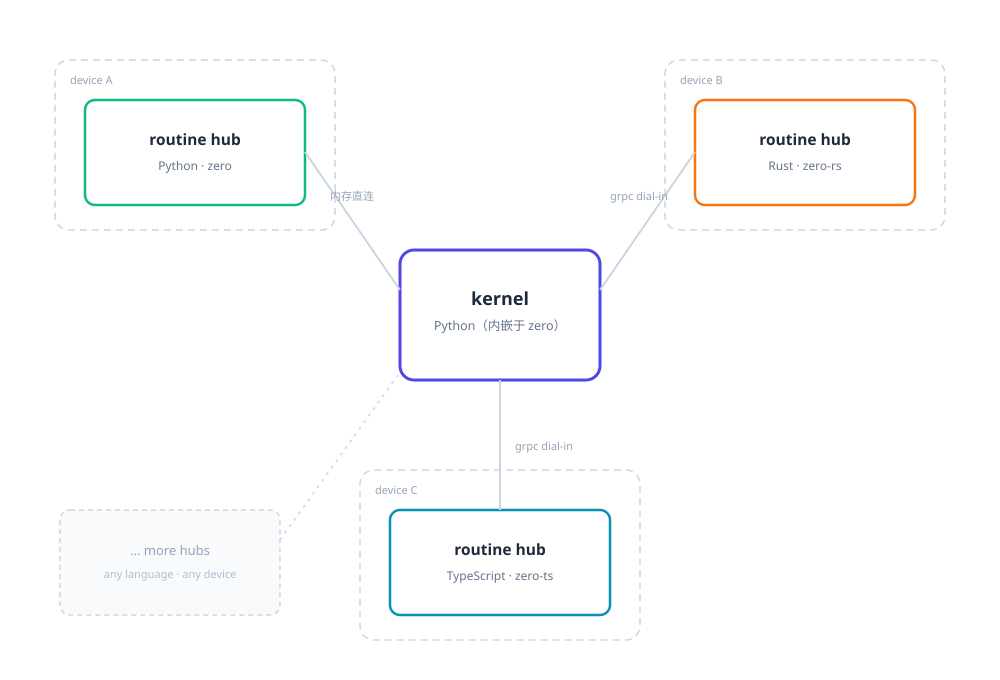

# zero-harness

Multi-language routine orchestration framework + LLM agent application skeleton.



[中文说明](README.zh.md)

## Design Philosophy

**Everything is a routine** — an agent is a routine, a tool is a routine, the web server
is a routine, even the loader and the watcher are routines. Routines can be written in
any language. Each hub is an independent process — any language, any device.

The kernel is embedded in the Python host process (asyncio implementation shipped with
`routine-py`, no separate deployment). External hubs (Rust / TypeScript / remote devices)
dial in via grpc.

Routines are enabled/disabled via `zero-py/app/routines.yaml` (comment out an entry to
disable); hot reload applies automatically.

## Quick Start (Windows)

Prerequisites: [uv](https://docs.astral.sh/uv/getting-started/installation/), bun or node.

1. Copy `zero-py/app/models.yaml.example` to `zero-py/app/models.yaml` and fill in your api_key
   (or keep the `$VAR` references and put the keys in `zero-py/.env`). `models.yaml` is
   required — without it the server registers nothing and exits with a hint.
2. Double-click `start.bat` in the repo root.

Open <http://localhost:5250> in your browser (the dev server port in
`frontend/web/vite.config.ts`; `start.bat` prints it too).

Optional: network config (listen addresses, robot device bus, rosbridge) lives in
`zero-py/app/config.yaml` — copy `config.example.yaml` to override. Without it the
defaults (all `127.0.0.1`) are used, which is enough for a local run.

## Example: Hello Routine

Create `zero-py/app/routines/user/hello.py`:

```python
from typing import Any, Dict
from routine import Routine

__all__ = ['Hello']          # 注册表只认 __all__ 导出的类, 漏了不会注册


class Hello(Routine):
    name = 'hello'
    meta = {'description': 'Say hello to someone'}

    async def run(self, kwargs: Dict[str, Any]):
        return f"Hello, {kwargs.get('name', 'World')}!"
```

Add one line to `zero-py/app/routines.yaml` — inside the existing `routines:` list, so keep
the two-space indent (hot reload applies it automatically):

```yaml
routines:
  # ...
  - routines/user/hello.py
```

Call it:

```bash
curl -X POST http://localhost:7781/run_routine -H "Content-Type: application/json" -d '{"name":"hello","kwargs":{"name":"World"}}'
# {"ok":true,"result":"Hello, World!"}
```

## More

- [zero-example](https://github.com/wangjackk/zero-example) — a complete application built on zero-harness (agents, presets, skills, TTS, frontend)
- [zero-py/routine-py/routine/docs/](zero-py/routine-py/routine/docs/) — framework API and concepts
- [zero-rs/routine-rs/examples/](zero-rs/routine-rs/examples/) — Rust SDK examples
