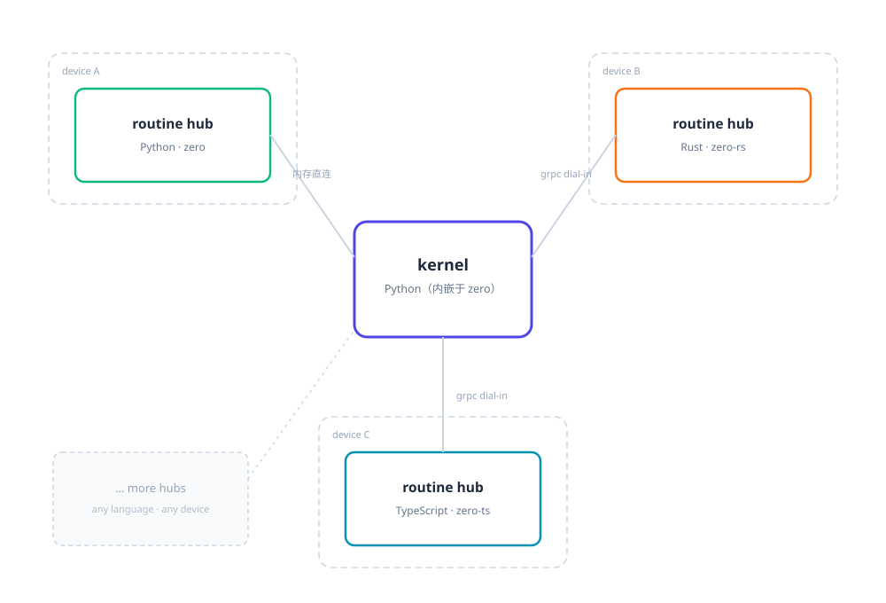

# zero-harness

多语言 routine 编排框架 + LLM agent 应用骨架。



[English](README.md)

## 设计哲学

**万物皆 routine**——agent 是 routine，工具是 routine，Web server 是 routine，连 loader
和 watcher 也是 routine。任何 routine 用任意语言编写。
每个 hub 独立进程、任意语言、任意设备。

kernel 内嵌于 Python 主进程（`routine-py` 自带 asyncio 实现，无需独立部署），
外部 hub（Rust / TypeScript / 远程设备）经 grpc dial-in 拨入。

## 快速开始（Windows）

前置：[uv](https://docs.astral.sh/uv/getting-started/installation/)、bun 或 node（任一）。

1. 复制 `zero-py/app/models.yaml.example` 为 `zero-py/app/models.yaml`，填入你的 api_key。
2. 双击根目录 `start.bat`。

浏览器打开 <http://localhost:5173>。

## 示例：Hello Routine

创建 `zero-py/app/routines/user/hello.py`：

```python
from typing import Any, Dict
from routine import Routine

class Hello(Routine):
    name = 'hello'
    meta = {'description': '向某人打招呼'}

    async def run(self, kwargs: Dict[str, Any]):
        return f"Hello, {kwargs.get('name', 'World')}!"
```

在 `zero-py/app/routines.yaml` 加一行（热重载自动生效）：

```yaml
- routines/user/hello.py
```

调用：

```bash
curl -X POST http://localhost:7781/run_routine -H "Content-Type: application/json" -d '{"name":"hello","kwargs":{"name":"World"}}'
# {"ok":true,"result":"Hello, World!"}
```

## 更多

- [zero-example](https://github.com/wangjackk/zero-example) — 基于 zero-harness 的完整应用示例（agents / presets / skills / TTS / 前端）
- [zero-py/routine-py/routine/docs/](zero-py/routine-py/routine/docs/) — 框架 API 与概念详解
- [zero-rs/routine-rs/examples/](zero-rs/routine-rs/examples/) — Rust SDK 示例
